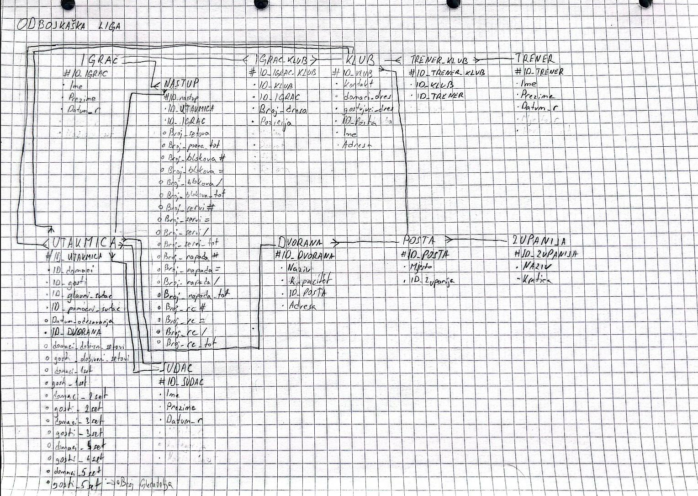
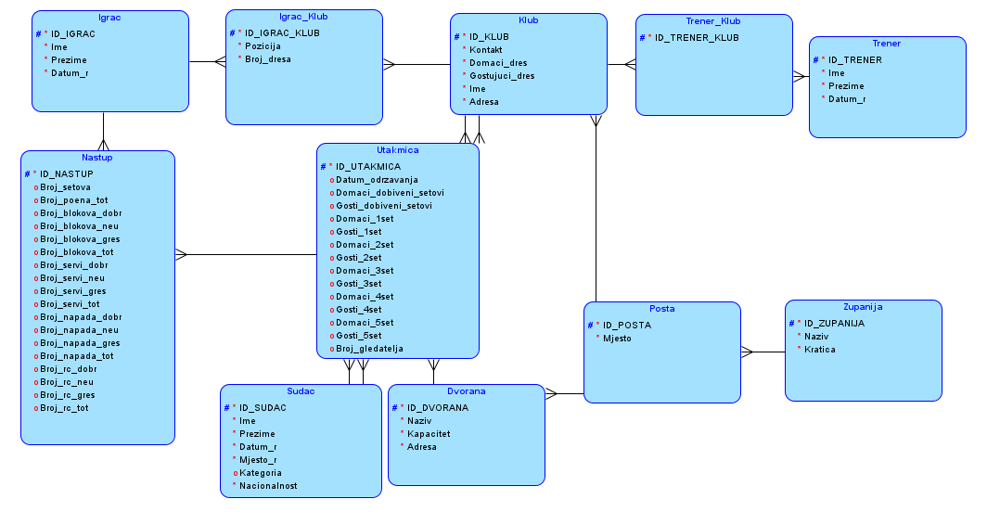
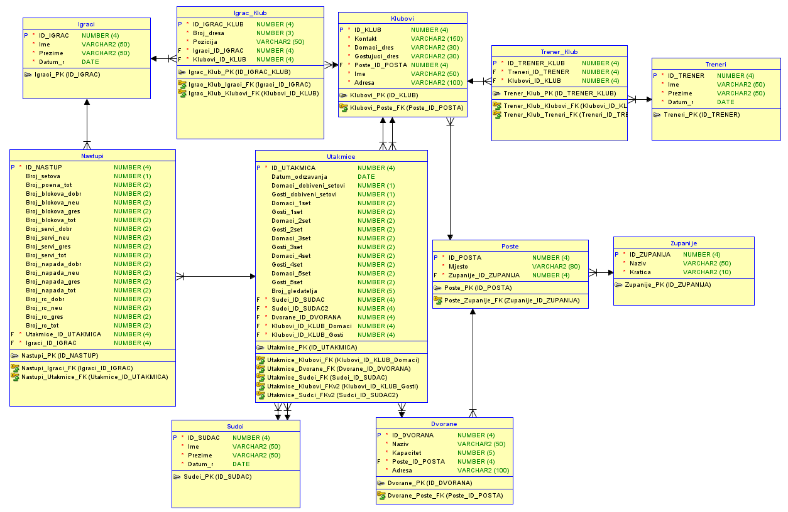

# Odbojkaška liga: baza podataka (Oracle)

Projekt iz kolegija **Informatički projekt iz baza podataka (IPBP)** na PMF-u u Splitu. Cilj je baza koja prati rezultate i statistiku odbojkaške lige: gdje i kada se igraju utakmice, tko igra za koji klub, tko vodi klubove i tko sudi, uz detaljnu statistiku svakog igrača po utakmici (napad, blok, servis, prijem).

Iz podataka je moguće izračunati npr. najboljeg igrača utakmice, postotak uspješnih napada, postotak prijema servisa te formu klubova u zadnjim utakmicama.

## Model baze

Baza ima **11 tablica** povezanih stranim ključevima.

| Tablica | Opis |
|---|---|
| `Igraci`, `Treneri`, `Sudci` | osnovni podaci o osobama (ime, prezime, datum rođenja) |
| `Klubovi` | kontakt, adresa, boje domaćeg i gostujućeg dresa |
| `Igrac_Klub` | za koji klub igrač igra, uz broj dresa i poziciju |
| `Trener_Klub` | koji trener vodi koji klub |
| `Utakmice` | datum, dvorana, domaćin i gost, glavni i pomoćni sudac, rezultati po setovima, broj gledatelja |
| `Nastupi` | statistika igrača na utakmici: blokovi, servisi, napadi i prijemi (dobri, neutralni, pogreške) |
| `Dvorane` | naziv, adresa i kapacitet |
| `Poste`, `Zupanije` | mjesta i županije za adrese klubova i dvorana |

Dizajnerske odluke:

- Veze **više na više** (igrač i klub, trener i klub, igrač i utakmica) riješene su veznim tablicama `Igrac_Klub`, `Trener_Klub` i `Nastupi`.
- Veznim tablicama namjerno je dan **surogatni primarni ključ** umjesto složenog, kako bi igrač mogao napustiti klub i vratiti se u njega nekoliko godina kasnije.
- Primarni ključevi generiraju se **sekvencama i okidačima** (`BEFORE INSERT` trigger), jer Oracle 11g nema auto-increment.
- Podaci se čuvaju provjerama (`CHECK`), npr. pozicija igrača mora biti jedna od: dizač, korektor, libero, primač, srednji bloker.

### Dijagrami

**Konceptualni model** (skica)



**Logički model**



**Relacijski model**



## Upiti

U datoteci [`sql/03_upiti.sql`](sql/03_upiti.sql) nalaze se četiri analitička upita:

1. **Gledanost klubova:** broj utakmica te prosječan, najmanji i najveći broj gledatelja u usporedbi s kapacitetom dvorane (`JOIN`, `GROUP BY`, agregatne funkcije).
2. **Usporedba igrača po pozicijama:** prosječni napadi, blokovi, servisi i prijemi.
3. **Top 5 igrača po postotku uspješnih napada:** uz uvjet minimalnog broja napada (`HAVING`, `NULLIF`, `ROWNUM`).
4. **Forma klubova u zadnjih 5 utakmica:** pobjede, porazi, razlika setova i niz rezultata (npr. `P-P-I-P-P`). Koristi **CTE** (`WITH`), prozorsku funkciju `ROW_NUMBER() OVER (PARTITION BY ...)`, `CASE` i `LISTAGG`.

## Kako pokrenuti

Potreban je Oracle Database i **Oracle SQL Developer**.

1. U SQL Developeru, kao administrator, napravi novog korisnika s pravima za izradu tablica, sekvenci i okidača te se spoji na njega. U novijim verzijama Oracle baze (12c i novije) imena korisnika moraju počinjati s `C##`.
2. Izvrši skriptu [`sql/01_ddl.sql`](sql/01_ddl.sql) kao skriptu (`F5`) da se izrade tablice, ograničenja, sekvence i okidači.
3. Izvrši [`sql/02_podaci.sql`](sql/02_podaci.sql) na praznoj bazi. Redoslijed naredbi je bitan jer se primarni ključevi generiraju sekvencama koje počinju od 1.
4. Pokreni upite iz [`sql/03_upiti.sql`](sql/03_upiti.sql).

### O podacima

- **Županije i klubovi** preuzeti su iz seminarskog rada (uz ispravljene tipfelere).
- Ostale tablice (pošte, dvorane, igrači, treneri, suci, utakmice i nastupi) napunjene su **izmišljenim testnim podacima**: 10 klubova s po 5 igrača, 25 utakmica (5 kola, svaki klub igra 5 utakmica) i 250 zapisa o nastupima. Imena, rezultati i statistike nisu stvarni, ali su međusobno dosljedni (ukupni brojevi odgovaraju zbroju dobrih, neutralnih i pogrešnih poteza, a rezultati setova odgovaraju pravilima odbojke).

## Struktura projekta

```
├── sql/
│   ├── 01_ddl.sql      # tablice, ograničenja, sekvence i okidači
│   ├── 02_podaci.sql   # INSERT naredbe (testni podaci)
│   └── 03_upiti.sql    # analitički upiti
├── model/              # projekt u Oracle SQL Developer Data Modeleru
│   ├── Baza_projekt.dmd
│   └── Baza_projekt/
├── slike/              # konceptualni, logički i relacijski model
└── docs/
    └── Seminarski_rad_Odbojkaska_liga.pdf   # cjelovit seminarski rad
```

Model se otvara u **Oracle SQL Developer Data Modeleru** (`File → Open → Baza_projekt.dmd`). Mapa `Baza_projekt/` mora ostati uz `.dmd` datoteku.

## Tehnologije

Oracle Database (SQL i PL/SQL okidači), Oracle SQL Developer, Oracle SQL Developer Data Modeler.

## Autor

**Lovro Maglica**, student informatike na PMF-u u Splitu. Akademska godina 2025./2026.
